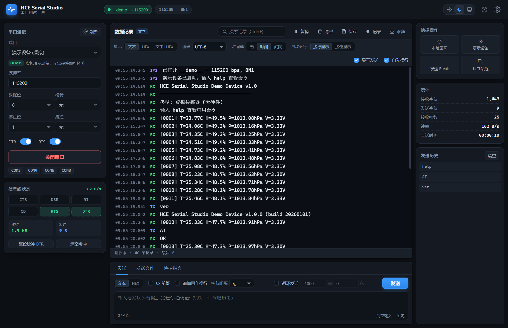
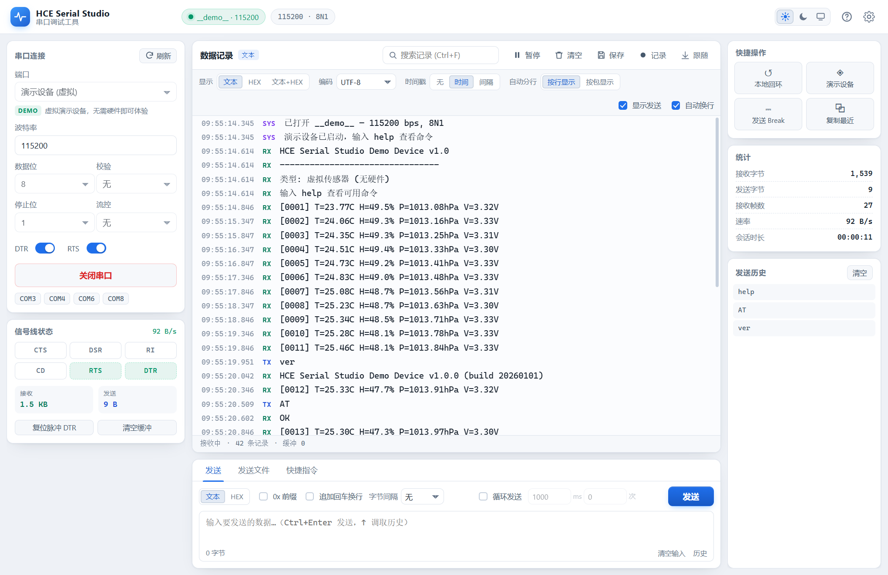
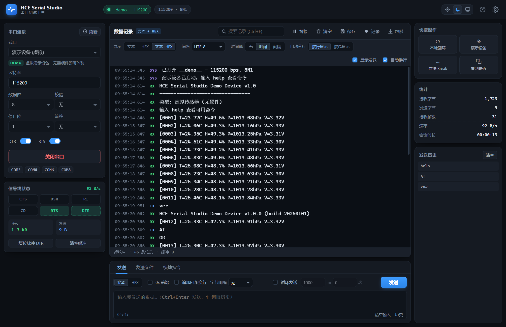

# HSE-Studio

**English** | [简体中文](README.zh-CN.md)

Debug tools for embedded engineers. The current release is **HSE Serial Studio** — a full-featured
serial port debugging tool for Windows.

Rust owns the serial port I/O and the front end only renders, so the app stays smooth through long
high-speed sessions — even on Bluetooth virtual COM ports, where the underlying Win32 calls can
block for seconds.

## Screenshots

| Dark theme | Light theme |
| :---: | :---: |
|  |  |

*Text + HEX dual view*



All screenshots show the built-in demo device, so you can reproduce them without any hardware.

## Features

### Serial connection

- Automatic port enumeration, showing device type (USB / Bluetooth / PCI), manufacturer, product
  name and VID/PID
- Baud rate presets plus free input, 5–8 data bits, parity, 1–2 stop bits, and hardware (RTS/CTS)
  or software (XON/XOFF) flow control
- DTR / RTS toggles — **both off by default**, so opening a port never pulls the lines high and
  resets your board by accident
- **DTR reset pulse** button: one-click MCU reset that restores the previous line level afterwards
- Live CTS / DSR / RI / CD signal indicators
- Cable unplug detection with automatic port release, plus optional auto-reconnect
- **Demo device** — a virtual sensor with a command parser, so every feature can be tried without
  hardware

### Logging and display

- **Text / HEX / Text + HEX** view modes, switchable at any time
- Timestamps: none, absolute time, or inter-frame delta
- Multi-encoding decoding: UTF-8, GBK/GB18030, Big5, Shift-JIS, EUC-KR, Windows-1252
- Line-based or packet-based splitting, with an optional wrap toggle
- **Cross-read line stitching**: the OS delivers serial data in ~16 ms chunks that do not align with
  newlines, so one log line often spans two reads. Line mode keeps the unfinished tail and joins it
  when the next chunk arrives
- Configurable receive buffer (default 5 000 lines, adjustable up to 200 000)
- **Virtualized rendering** — only the rows near the viewport are mounted as DOM nodes, so a
  50 000-line session has the same DOM footprint as a 300-line one
- Control characters rendered as visible glyphs (`␛`, `␍`, `␀`, …)
- Search with live highlighting, match counter and next / previous jumps
- Pause display (data keeps arriving in the background) and auto-scroll follow
- Clear the log, save it to a file, or **stream it straight to disk** during long captures
- Live statistics: RX/TX bytes, frame count, throughput and session duration

### Sending

- Text or HEX input; HEX accepts `01 03 00 00`, `0x01,0x03` and `01030000`
- Optional CRLF append and per-byte send gap
- **Repeat send** with configurable interval and count (0 = unlimited)
- Send history with automatic de-duplication, `↑` / `↓` recall and click-to-reuse
- **Send file**: drag and drop or pick a file of any size, with chunk size, chunk interval, line
  interval, HEX-text decoding and LF → CRLF conversion, plus a progress bar and cancel
- **Quick commands**: add, edit and delete text/HEX macros with optional CRLF/LF, bound to
  `Ctrl+1` … `Ctrl+9`

### General

- Dark / light / follow-system themes
- Everything persisted locally: settings, quick commands and send history
- Local loopback (echo received bytes back), send a Break signal, copy the most recent 20 log lines
- Full keyboard shortcut coverage

## Performance

The log is rendered by a windowed (virtualized) engine:

- All data lives in lightweight in-memory records; only rows near the viewport become DOM nodes
- A 50 000-line session keeps ~60 row nodes mounted, the same as a 300-line session
- Steady-state refreshes are driven by a single 20 Hz batched timer instead of one layout per packet

Measured with sustained input at roughly 200 000 characters/second:

| Scenario | Frame rate |
| --- | --- |
| Idle | 60 fps |
| 115 lines/s (text at 115 200 baud) | 60 fps |
| 920 lines/s (text at 921 600 baud) | 60 fps |
| 20 000 buffered lines while scrolling | 60 fps |

UI latency with an 8 000-line buffer: tab switch 0.5–4.6 ms, view-mode switch 6–8 ms.

### Serial responsiveness

- Opening and closing a port runs on a blocking thread pool, so the window never freezes; the button
  shows elapsed time with an animated progress bar
- Modem-line state is sampled by a background thread every 400 ms, and `read_status` only reads the
  cached snapshot
- DTR / RTS / Break use a separate handle that never competes with the open/close/send locks
- Front-end polling is in-flight guarded, so requests never pile up

With a deliberately slow 5.2 s port opening the main thread's longest stall stayed below 64 ms.

## Keyboard shortcuts

| Shortcut | Action |
| --- | --- |
| `Ctrl` + `Enter` | Send current input |
| `Ctrl` + `L` | Clear log |
| `Ctrl` + `S` | Save log |
| `Ctrl` + `F` | Search |
| `Ctrl` + `K` | Focus the send box |
| `Ctrl` + `O` | Open / close the port |
| `Ctrl` + `1` … `9` | Send quick command N |
| `F1` | Help |
| `F5` | Refresh the port list |
| `Space` | Pause / resume display |
| `Esc` | Close dialog / stop repeat send |
| `↑` `↓` | Recall send history (inside the input box) |

## Download and install

The Windows installer ships in this repository:

- **[HSE Serial Studio v1.0.1 (x64)](<HSE Serial Studio/HCE Serial Studio_1.0.1_x64-setup.exe>)** —
  1.57 MB, file name `HCE Serial Studio_1.0.1_x64-setup.exe`

Requirements: Windows 10/11 (x64) with the WebView2 runtime, which is preinstalled on Windows 11
and current Windows 10 builds. If it is missing, install the
[WebView2 Runtime](https://developer.microsoft.com/microsoft-edge/webview2/) first.

The build is not code-signed, so SmartScreen may warn on first run — choose **More info → Run
anyway**.

## Repository layout

```
README.md            English documentation (this file)
README.zh-CN.md      Chinese documentation
assets/              Screenshots and the donation QR code
HSE Serial Studio/   Windows installer (v1.0.1)
```

## Notes

- If a port is already in use, the app says so explicitly and keeps retrying on a timer when
  auto-reconnect is enabled.
- The demo device is always available in the port list — pick “演示设备 (虚拟)” to explore the app
  without hardware. It answers `help`, `ver`, `start` / `stop`, `rate <ms>`, `bin`, `echo <text>`
  and `AT`.
- In HEX mode every frame gets its own address column, which makes binary protocols easier to read.

## Support the project

If HSE Serial Studio saves you time, you are welcome to buy me a coffee — scan the Alipay QR code:


Donations are entirely optional; bug reports and feature requests are just as welcome.
