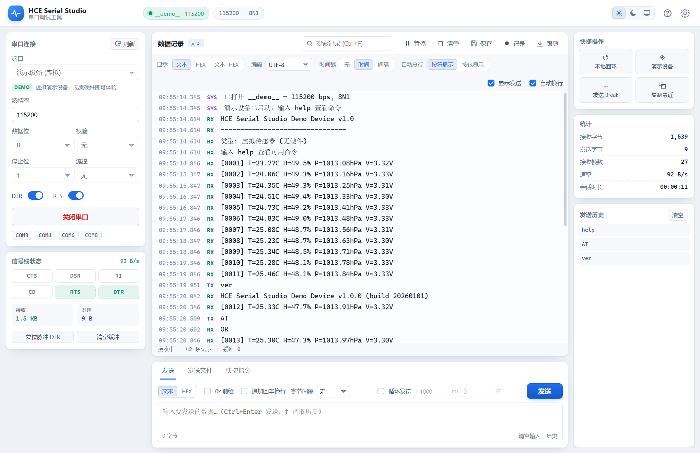
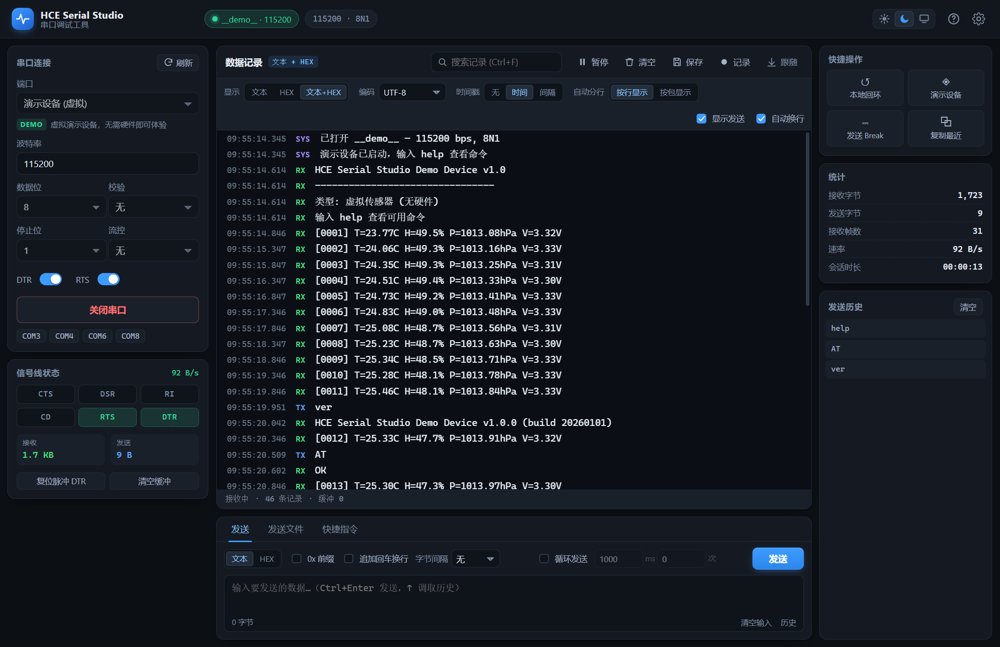
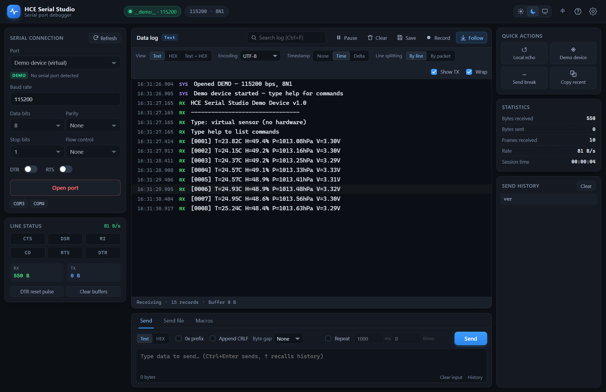
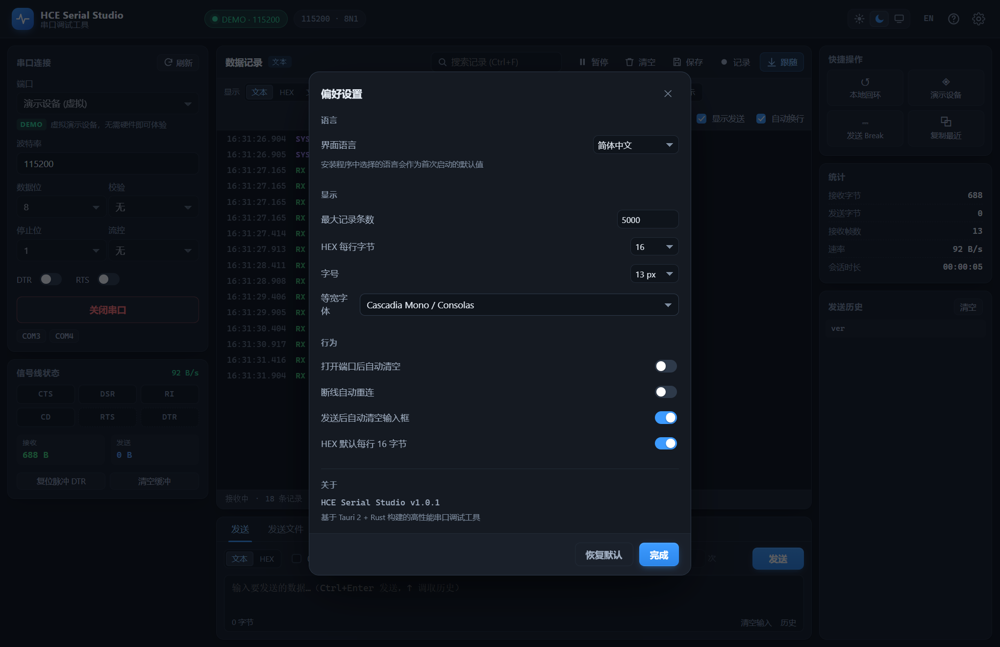

# HSE-Studio

[English](README.md) | **简体中文**

面向嵌入式工程师的调试工具集。当前版本 **HSE Serial Studio** 是一个Windows 全功能串口调试工具。

Rust 负责串口 I/O，前端只负责渲染，因此长时间、高速率收发也不会卡顿 —— 即使在蓝牙虚拟串口上
（底层 Win32 调用可能阻塞数秒）同样保持跟手。

## 应用截图

| 深色主题 | 浅色主题 |
| :---: | :---: |
|  |  |

*文本 + HEX 双视图*



*英文界面*



*偏好设置 —— 界面语言可随时切换*



以上截图均使用内置演示设备录制，无需任何硬件即可复现。

## 功能

### 串口连接

- 自动枚举串口，显示设备类型（USB / 蓝牙 / PCI）、厂商、产品名与 VID/PID
- 波特率常用预设 + 自定义输入，数据位 5–8，校验位，停止位 1–2，流控支持硬件 RTS/CTS 与
  软件 XON/XOFF
- DTR / RTS 可随时切换，**默认均为关闭**：打开串口时不会主动拉高，避免意外复位外设
- **DTR 复位脉冲**：一键复位单片机，结束后自动恢复到之前勾选的电平
- 实时显示 CTS / DSR / RI / CD 信号线状态
- 拔线自动检测并释放端口，可选断线自动重连
- **演示设备**：带命令解析的虚拟传感器，没有硬件也能体验全部功能

### 数据记录与显示

- **文本 / HEX / 文本+HEX** 三种显示模式，可随时切换
- 时间戳：无 / 绝对时间 / 帧间间隔
- 多字符编码：UTF-8、GBK/GB18030、Big5、Shift-JIS、EUC-KR、Windows-1252
- 按行显示或按包显示，可开关自动换行
- **跨包行拼接**：串口数据按操作系统的读取块到达（约每 16 ms 一块），并不按换行对齐，
  一行日志经常被拆到两次读取里。按行显示模式会保留未结束的行尾，等下一块数据到达后再
  拼接成一整行
- 接收缓冲区上限可配置（默认 5000 行，最高可调到 200000 行）
- **虚拟滚动渲染**：无论累积多少行，DOM 中始终只保留视口附近的行，5 万行会话与 300 行会话
  的 DOM 规模相同
- 控制字符可视化（`␛` / `␍` / `␀` 等），避免不可见字符引起误解
- 搜索：实时高亮、匹配计数、上下跳转
- 暂停显示（数据继续在后台接收）、自动跟随滚动
- 一键清空、保存为文本、**实时写入文件**（长时间抓包不占内存）
- 实时统计：接收 / 发送字节数、帧数、速率、会话时长

### 数据发送

- 文本 / HEX 双模式；HEX 支持 `01 03 00 00`、`0x01,0x03`、`01030000` 三种写法
- 可追加 CRLF、设置逐字节发送间隔
- **循环发送**：可设间隔与次数（0 = 无限）
- 发送历史：自动去重，`↑` / `↓` 调取，可点击复用
- **发送文件**：拖拽或选择文件，支持任意大小，可设分块大小、分块间隔、行间隔、HEX 文本解码、
  换行转 CRLF，带进度显示与取消
- **快捷指令**：可增删改，支持文本 / HEX、追加 CRLF / LF，`Ctrl+1`…`Ctrl+9` 快捷发送

### 其它

- **多语言**：简体中文 / English，可在标题栏一键切换，或在设置中选择
- 深色 / 浅色 / 跟随系统三种主题
- 所有设置、快捷指令、发送历史本地持久化
- 本地回环（收到的数据原样回发）、发送 Break 信号、复制最近 20 行记录
- 完整键盘快捷键

## 多语言

界面完整支持**简体中文**与 **English** 两种语言，覆盖所有界面文案、提示消息、对话框标题，
以及后端返回的错误信息与演示设备的命令输出。

### 切换方式

| 位置 | 说明 |
| --- | --- |
| 标题栏 `EN` / `中` 按钮 | 一键切换，立即生效 |
| 设置 → 界面语言 | 跟随系统 / 安装程序、简体中文、English |

选择会保存在本地，下次启动继续沿用。

### 安装时选择语言

安装程序内置语言选择对话框（简体中文 / English）。**安装时选择的语言，就是软件首次启动时
使用的语言**，无需再手动切换。

实现分两步：

1. 安装程序通过 `tauri.conf.json` 中的 `"languages": ["SimpChinese", "English"]` 与
   `displayLanguageSelector: true` 打开 NSIS 语言选择对话框。
2. 安装钩子把所选语言写入 `HKCU\Software\alan\HCE Serial Studio\Installer Language`
   （`2052` = 简体中文，`1033` = English）。启动时后端通过 `app_info` 以 `installLanguage`
   返回该值，前端在尚未保存过显式选择时采用它。

语言解析顺序为：全新安装时以安装程序语言优先，其次才是软件内的显式选择，最后回退到操作系统
语言。

## 性能

日志采用**窗口化（虚拟滚动）渲染**：

- 所有数据保存在内存中的轻量记录里，只有视口附近的行才真正挂载为 DOM
- 5 万行会话与 300 行会话的 DOM 规模相同（约 60 个行节点）
- 稳态刷新由单一定时器驱动（20 Hz 合并刷新），避免每个数据包都触发一次重排

实测（20 万字符/秒级别的持续输入）：

| 场景 | 帧率 |
| --- | --- |
| 空闲 | 60 fps |
| 115 行/秒（115200 波特率文本） | 60 fps |
| 920 行/秒（921600 波特率文本） | 60 fps |
| 20000 行缓存 + 滚动 | 60 fps |

界面交互延迟（8000 行缓存下）：标签切换 0.5–4.6 ms、视图切换 6–8 ms。

### 串口操作的响应性

- **打开 / 关闭串口**在阻塞线程池执行，窗口不会冻结；按钮上显示已用时间与动态进度条
- **信号线状态**由后台线程每 400 ms 采集一次并缓存，`read_status` 只读缓存，不再直接
  调用 Win32
- **控制线（DTR / RTS / Break）** 使用独立句柄，不与打开 / 关闭 / 发送争锁
- 前端状态轮询带"在途保护"，绝不会把请求排队堆积

实测（含 5.2 秒的慢速串口打开）：主线程最大停顿 **< 64 ms**。

## 快捷键

| 快捷键 | 功能 |
| --- | --- |
| `Ctrl` + `Enter` | 发送当前输入 |
| `Ctrl` + `L` | 清空记录 |
| `Ctrl` + `S` | 保存记录 |
| `Ctrl` + `F` | 搜索 |
| `Ctrl` + `K` | 聚焦发送输入框 |
| `Ctrl` + `O` | 打开 / 关闭串口 |
| `Ctrl` + `1`…`9` | 发送第 N 个快捷指令 |
| `F1` | 帮助 |
| `F5` | 刷新串口列表 |
| `Space` | 暂停 / 恢复刷新 |
| `Esc` | 关闭弹窗 / 停止循环发送 |
| `↑` `↓` | 输入框内调取发送历史 |

## 下载与安装

Windows 安装包随仓库提供：

- **[HSE Serial Studio v1.0.2（x64）](<HSE Serial Studio/HCE Serial Studio_1.0.2_x64-setup.exe>)** —
  1.59 MB，文件名 `HCE Serial Studio_1.0.2_x64-setup.exe`

系统要求：Windows 10/11 x64，需要 WebView2 运行时（Windows 11 及较新的 Windows 10 已内置）。
如缺失，请先安装 [WebView2 运行时](https://developer.microsoft.com/microsoft-edge/webview2/)。

安装包未做代码签名，首次运行可能触发 SmartScreen 提示 —— 选择**更多信息 → 仍要运行**即可。

## 仓库结构

```
README.md            英文文档
README.zh-CN.md      中文文档（本文件）
assets/              应用截图与捐赠收款码
HSE Serial Studio/   Windows 安装包（v1.0.2）
```

## 说明

- 端口被其它程序占用时会给出明确提示；开启自动重连后会定时重试。
- 演示设备在端口列表中始终可见，选择「演示设备 (虚拟)」即可在无硬件环境体验。它支持
  `help`、`ver`、`start` / `stop`、`rate <ms>`、`bin`、`echo <text>` 和 `AT` 命令。
- HEX 显示模式下每帧独立地址列，便于分析二进制协议。

## 支持作者

如果 HSE Serial Studio 帮你节省了时间，欢迎请我喝杯咖啡 —— 支付宝扫码：


打赏完全自愿，提交问题反馈和功能建议同样欢迎。
